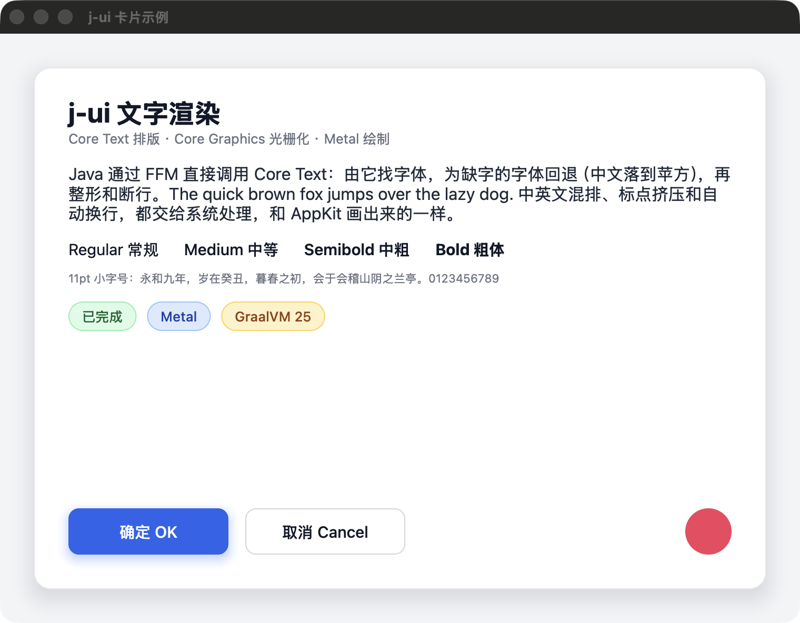
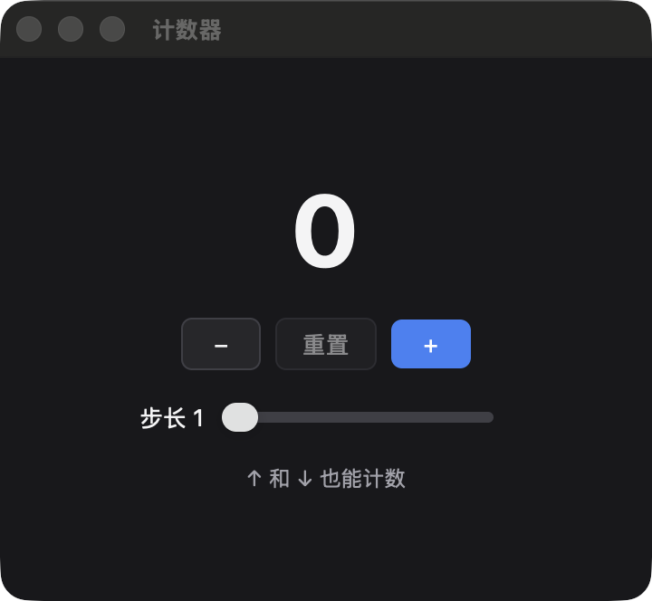
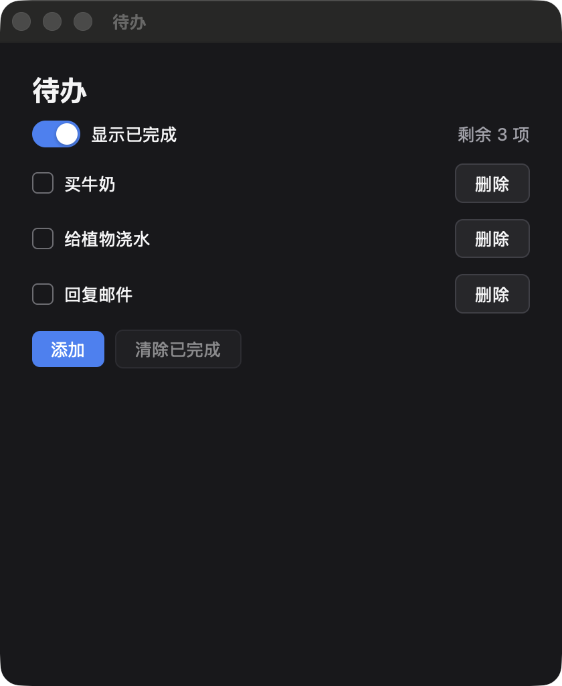
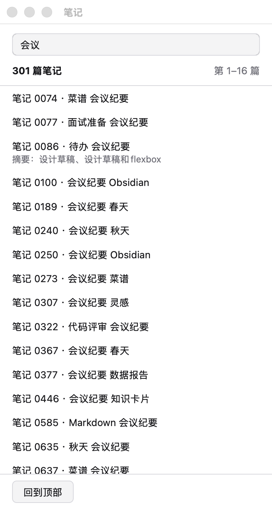
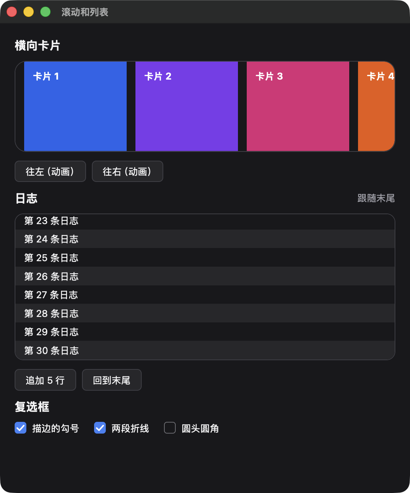
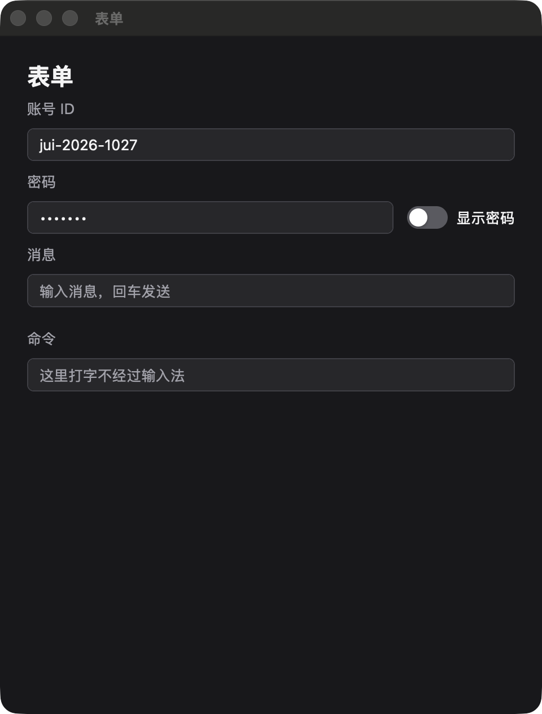

# j-ui

在 GPU 上自绘界面的 Java 桌面 UI 框架的技术验证：Java 通过 FFM（`java.lang.foreign`）直接调用 macOS 的 AppKit、Metal 和 Core Text，不写一行 C/Objective-C，再用 GraalVM Native Image 编译成原生可执行文件。

结构参照 [egoist/mygo](https://github.com/egoist/mygo)（MIT）的 `internal/darwin`、`internal/gpu/metal` 和 `internal/text`：MyGO 用 purego 做的事，这里用 FFM 做。


## 验证结果（2026-10-24）

环境：Apple Silicon，macOS 26.6.1，GraalVM CE 25 Innovation 4（JDK 25.0.4），Retina 屏（缩放 2 倍），窗口 760×560 点。

### 启动、内存、体积

`./build.sh bench 10` 的结果：每种方式跑 10 次取中位数，第一次运行不计入。时间从进程启动算起，单位毫秒；内存是空闲 3 秒后的物理占用（活动监视器的口径）。

| 方式 | 到 main() | 应用启动完成 | 窗口和 Metal 就绪 | 首帧提交 | GPU 画完首帧 | 空闲内存 | 体积 |
|---|---|---|---|---|---|---|---|
| Java native image（含文字） | 5.3 | 67.5 | 111.0 | 128.7 | **133.1** | **45.3 MB** | 13.3 MB |
| Java，在 JVM 上（含文字） | 108.8 | 187.3 | 233.8 | 275.6 | 280.1 | 134.0 MB | 需要 JDK |
| 纯 Objective-C（对照，只画方框） | 4.6 | 62.3 | 101.7 | 109.9 | 114.4 | 37.7 MB | 58 KB |

- 启动耗时的大头是 macOS 自身：启动 AppKit 约 55 毫秒，创建窗口、Metal 设备和管线约 40 毫秒。
- Java native image 画了 239 个字形的中英文，比只画方框的 Objective-C 多约 19 毫秒，其中文字约 10 毫秒（见下表）。
- 计时口径和 MyGO 的 `ContentWindowOpen` 基准一致，都算到“画出第一帧”为止。画面在之后的下一次屏幕刷新时上屏，120Hz 屏最多再晚约 8 毫秒。
- 作为参考，MyGO 文档里的数据是：counter 示例的二进制 8.9 MB，空闲内存在 M5 MacBook 上 37 MB。
- native-image 构建一次约 16 秒，构建过程峰值内存约 1.5 GB；用 `-Os` 编译体积还能再小约 2 MB。

### 文字

演示窗口里共 282 个实例，其中 239 个字形是首帧第一次光栅化进图集的。

| | native image | JVM |
|---|---|---|
| 首帧画文字（排版 + 光栅化 + 进图集） | 10.3 ms | 30.6 ms |
| 其中排版（Core Text） | 6.1 ms | 11.4 ms |
| 其中光栅化 239 个字形（Core Graphics） | 3.9 ms | 11.1 ms |
| 缓存命中后重画整帧 | 0.009 ms | 0.080 ms |
| 一次 FFM 调用 | 6.1 ns | 5.1 ns |

做法和 MyGO 一样：

- **排版**：Core Text 的 typesetter 负责断行，再从每个 run 的属性里取出实际用到的字体，中文会自动回退到苹方。设置了 `zh-Hans` 语言属性来选中文字形，系统字体通过 `NSFont` 取，字重准确。
- **光栅化**：用 Core Graphics 的纯透明度位图上下文画字形，开启字体平滑，并按文字颜色的亮度分 4 档。子像素位置按 `min(5, ⌈100/(3·px)⌉)` 量化，基线对齐到整像素。
- **绘制**：窗口的 R8 字形图集从 1024×1024 起步，支持坐标不变地扩至 4096×4096，平时只上传改动区域，扩容时整图上传。字形四边形和像素网格对齐，着色器直接按像素读取覆盖率。

### 已验证可行的点

- 全部原生调用都走 FFM，没有 JNI，也没有 C 代码：`objc_msgSend` 按签名绑定，结构体按值传递和返回（CGRect、CGSize、CFRange、MTLRegion、MTLClearColor）都可用。
- 在运行时定义 Objective-C 类，方法用 Java 实现（FFM upcall），包括调用父类实现。
- 用 FFM 手工构造 Objective-C block 交给 Metal；Metal 从它自己的线程回调 Java，JVM 和 native image 下都正常。
- native image 的 `main()` 就运行在进程主线程上，AppKit 可以直接用；JVM 下则需要加 `-XstartOnFirstThread`。
- 预编译的 metallib 作为资源打进 native image，运行时通过 `newLibraryWithData:` 加载，不需要在启动时编译着色器。
- Core Text 排版、字体回退、多种字重、自动换行，以及 Core Graphics 光栅化和字形图集，都已在 native image 里跑通。

### 踩到的坑

- **native image 里，FFM 句柄必须放在构建期初始化的类里，否则每次调用要约 1.7 微秒，比 JVM 慢 300 倍。** 原因是运行期初始化的类里的句柄，编译时不是常量，调用会退回到通用的 MethodHandle 路径。这里的做法是 `jui.ffi.Native`：每个签名一个不绑定函数地址的句柄，函数地址在运行期查到后作为第一个参数传入；这个类不持有任何原生地址，所以可以 `--initialize-at-build-time`。改完后一次调用 6 纳秒，首帧文字从 23 毫秒降到 10 毫秒。
- native-image 默认把最低系统版本设成构建机的 macOS 版本（这里是 26.0），程序在旧系统上会打不开。需要加 `-H:NativeLinkerOption=-mmacosx-version-min=13.0`；设置 `MACOSX_DEPLOYMENT_TARGET` 环境变量没有效果。
- native image 链接的是本机 Xcode 的 SDK（27.0），所以窗口自动是 macOS 26 的新外观（标题靠左、标题栏更高）；`java` 启动器是用 SDK 14.5 链接的，窗口还是旧外观。
- 每次重新编译后，第一次运行要多花约 470 毫秒，这是 macOS 对新可执行文件的首次检查。正式发布时要签名和公证。
- `javac --release 25` 看不到 GraalVM 的 `org.graalvm.nativeimage` 模块，编译 Feature 类要改用 `--add-modules`。
- 窗口第一次显示时，那一帧是跟着窗口由系统合成上屏的，Metal 报告的 `presentedTime` 为 0，所以计时改用 command buffer 的完成时间。
- 原生签名、回调目标和资源都要在构建期登记。这里统一放在 `Sigs` 和 `NativeImageFeature` 里，写一次就够了，JVM 和 native image 用的是同一份代码。

### 还没验证的

- 彩色字形（emoji）：需要再加一张彩色图集，目前直接跳过不画。
- 图集逐出、回收和重排尚未实现；计划四只补上了有上限的扩容，到上限仍明确报告 full。
- 和 AppKit 自己画的文字逐像素对比：MyGO 做过，这里只是肉眼看起来一致。
- 完整从右到左的视觉编辑；输入法和普通文本编辑的后续验证见 M4 及多行文本框专节。
- 拖动改变窗口大小时的同步呈现路径：代码已经写了，没有手动拖动测试过。
- Intel Mac：GraalVM 的 FFM 不支持 macOS x64。

## M1：即时模式 API 骨架（2026-10-25）

按[设计文档](docs/design/2026-10-24-ui-api-design.md)和 [M1 计划](docs/plans/2026-10-24-m1-engine-skeleton.md)实现了 MyGO 风格 API 的骨架，包括：
- `Context`、`Element`、节点池、身份和 key；
- `box`、`row`、`column`、`spacer`、`divider`、`text`；
- 不含换行和绝对定位的 flexbox；
- 绘制到 `Scene`、按需出帧；
- `Tester`，以及 `App` 和 `Window`。

验收示例 `jui.examples.CardDemo` 用新 API 重写了原型的卡片，在 native image 下的画面如下：



写法和 MyGO 一一对应（节选）：

```java
public static void view(Context c) {
    box(c).fill().background(PAGE).padding(32).children(() ->
        column(c).grow(1).background(WHITE).border(1, CARD_BORDER).radius(16)
            .shadow(0, 8, 24, 0, CARD_SHADOW).padding(26, 32, 32, 32).children(() -> {
                text(c, "j-ui 文字渲染").fontSize(26).bold().textColor(INK);
                text(c, PARAGRAPH).fontSize(16).textColor(BODY).margin(16, 0, 0, 0);
                ...
                spacer(c);
                row(c).gap(16).children(() -> {
                    button(c, "确定 OK", ACCENT, null, WHITE).shadow(0, 4, 12, 0, ACCENT_SHADOW);
                    button(c, "取消 Cancel", WHITE, BUTTON_BORDER, INK);
                    spacer(c);
                    box(c).size(44, 44).radius(22).background(ROSE);
                });
            }));
}
```

- 测试：`./build.sh test`，47 个测试全部通过，用的是仓库里的零依赖运行器。
- 运行：`./build.sh demo`（JVM）或 `./build.sh native-demo`（native image）。
- native image 下：体积 12.8 MB，空闲内存 45.2 MB。
- 分配：native image 下，包括文字在内的整帧（构建、布局、绘制），框架内部不分配；卡片示例整帧 200 字节，全部来自示例自己的 lambda。详见下一节。

## M1 分配实测（2026-10-24）

设计文档第 8 节要求在写控件之前，先在 native image 上测清楚 UI API 每帧分配多少内存。`./build.sh alloc` 会把 `jui.spike.AllocSpike` 编译成 native image 运行，再在 JVM 上跑一次作为参照。

测量方法：
- 统计的是主线程分配的字节数（`ThreadMXBean.getCurrentThreadAllocatedBytes`，native image 里也能用）；
- 每个场景先预热 2 万帧，再测 1000 帧，扣除空帧后取平均；
- 下表的场景每帧包括构建和布局；最后两个场景还包括绘制文字。

| 场景（单位：字节） | 第一次 native | 启用句柄复用后 native | JVM 参照 |
|---|---|---|---|
| 空帧（整帧） | 0 | 0 | 0 |
| `Element` 句柄（每个元素） | 24 | **0** | 0 |
| 捕获变量的 `children` lambda（每个容器） | 64 | 16 | 0 |
| 临时 `BoolRef` 传给控件（每次） | 64 | 16 | 0 |
| `key(long)`（每行） | 24 | 0 | 0 |
| `key(Object)`，传入装箱的 Long（每行） | 24 | 0 | 24 |
| 模拟外壳整帧（200 句柄 + 60 lambda 容器 + 10 临时引用 + 30 带 key 行） | 10000 | **1120** | 0 |
| 纯文字视图整帧，含绘制（5 段文字，157 个实例，没有 lambda） | 12616 → 2792 → **0** | — | 0 |
| 卡片示例整帧，含绘制 | — | **200** | 544 |

最后两行是代码审查之后补测的。纯文字那一行的三个数字依次是：修复前；字形图集改用 `long` 键之后；`shadeOf` 改用查找表之后（`Math.pow` 在 native image 里每次调用都会分配）。排版缓存的命中原来也会分配一个键对象，同样改成了 `long` 键。

原始输出（最后一行 native 是全部修复之后的结果）：

```
ALLOC mode=native empty_frame=0 handles=24.0 lambdas=64.0 temprefs=64.0 key_long=24.0 key_object=24.0 shell_frame=10000
ALLOC mode=native empty_frame=0 handles=0.0 lambdas=16.0 temprefs=16.0 key_long=0.0 key_object=0.0 shell_frame=1120 text_frame=0 text_instances=157 card_frame=200
ALLOC mode=jvm empty_frame=0 handles=0.0 lambdas=0.0 temprefs=32.0 key_long=32.0 key_object=56.0 shell_frame=320 text_frame=0 text_instances=157 card_frame=544
```

`./build.sh alloc` 现在也是一道检查：native image 下，纯文字视图平均每个实例分配超过 0.5 字节，或卡片示例整帧超过 32 KB，就返回失败。

结论：

- **GraalVM 社区版的 native image 消除不掉 `Element` 句柄**，每个元素 24 字节（HotSpot 的 C2 编译器能消掉）。所以按设计 7.1 的退路，正式版（开发模式关闭时）复用句柄（`Context.POOLED_HANDLES`）：每个节点编号对应一个固定的 `Element` 对象，每帧更新它的代数。开发模式仍然为每个元素新建句柄，这样即使把 `Element` 存起来、在后面的构建里再用，也能被发现。
- **框架内部的分配为 0，包括文字的排版和绘制**，满足“不能产生和元素数量成正比的分配”。
- **剩下的分配都来自应用代码的写法**：捕获变量的 lambda 和临时创建的引用对象，各 16 字节。模拟外壳整帧 1120 字节，卡片示例整帧 200 字节，都远低于 32 KB 的预算，**公开 API 不需要调整**。
- 不要把 `Element` 存进字段：正式版不检查这种误用，它可能会修改到这一帧同一编号上的另一个元素。

## M2：交互（2026-10-25）

按 [M2 计划](docs/plans/2026-10-25-m2-interaction.md)实现了交互，行为对照 MyGO（commit `8049993`）的 `ui/input.go`、`ui/runtime.go` 和 `ui/widgets.go`。

**指针**
- 悬停、按下、点击、双击、右键（或 Control 加单击）、拖动。
- 对应的查询：`hovered()`、`pressed()`、`clicked()`、`clicks()`、`doubleClicked()`、`rightClicked()`、`dragX()`/`dragY()`。
- 按住期间悬停状态冻结，在别处松开不算点击。

**重建规则**
- 某一遍构建报告了输入或执行了回调，就再建一遍，一帧最多 3 遍。
- 每次输入只报告一次。
- 回调 `onClick`、`onChange` 在这一遍的视图建完后执行，所以可以修改正在遍历的列表。

**焦点和键盘**
- 点击聚焦；Tab、Shift+Tab 按构建顺序循环；回车和空格激活获得焦点的元素。
- 焦点环只在用键盘切换焦点后显示。
- `Handle` 可以从任意动作请求焦点，`autoFocus()` 让元素出现时就获得焦点。

**快捷键**
- `element.shortcut(...)` 在焦点位于该元素内部时报告，`c.shortcut(...)` 是窗口级的。
- 获得焦点的元素优先于窗口；修饰键必须完全一致。

**控件**
- `button`、`primaryButton`、`checkbox`、`toggle`（开关）、`slider`。
- 无外观的基础版：`buttonBase`、`toggleBase`、`sliderBase`。
- 外观照 MyGO，主题改用 MyGO 的浅色和深色配色。

**局部状态和其他**
- `local`、`localBool`、`localFloat`，跟着元素的身份走，元素不再出现就回收。
- `disabled()`（子元素继承）、`opacity()`、`bounds()`。

**明暗切换**：默认跟随系统外观，系统切换时窗口跟着重画。

**macOS 平台**
- 视图接收鼠标、键盘、修饰键事件，同 MyGO 的 `internal/darwin/surface.go`。
- 窗口代理报告窗口是否在前台，外观变化时视图会收到通知。

两个验收示例在 native image 下的画面如下（这台 Mac 当时是深色外观）：

| 计数器 `./build.sh demo Counter` | 待办清单 `./build.sh demo Todo` |
|---|---|
|  |  |

- **计数器**：照 MyGO 的 `examples/counter-native`，加了一个步长滑块。按钮和 ↑/↓ 都按步长计数，计数为 0 时“重置”禁用。
- **待办清单**：每条待办一个复选框，行按 id 作 key，“删除”的回调直接从列表里移除，开关隐藏已完成的，⌘N 新增。没有文字输入（M4 才做），所以待办的标题是固定的。
- **测试**：`./build.sh test`，138 个测试全部通过。Tester 覆盖了点击、Tab、空格、方向键和快捷键。
- **分配**：控件帧（40 个按钮、40 个复选框、20 个滑块）在 native image 下，框架内部每个控件分配 0 字节，指针悬停在按钮上时也是 0；卡片整帧仍是 200 字节（`./build.sh alloc`）。
- **已手动核对通过**：用真实鼠标和键盘试过两个示例，悬停变色、点击、焦点环、方向键计数，以及切换系统外观都正常。从 AppKit 事件到引擎的路径另由 `MacWindowInputTest` 用真实的 `NSEvent` 自动测试。

**推迟到后面的**
- `cursor(Cursor)`、`onSubmit`/`submitted()` 推到 M4，和文本输入一起做；
- `c.now()`、`c.after(...)`、`Tester.advance` 推到 M3，和 display link 一起做；
- 开关的滑动动画推到 M3；
- 勾选标记先用文字“✓”，M6 有了线段图元再换成描边。

## M3：滚动和列表（2026-10-26）

按 [M3 计划](docs/plans/2026-10-25-m3-scroll-and-list.md)实现了滚动和长列表，行为对照 MyGO（commit `8049993`）的 `ui/scroll.go`、`ui/list.go`、`ui/wheel.go` 和 `ui/layout.go`。

**滚动容器**
- `scroll(c)` 和 `scroll(c, ScrollState)`：纵向滚动，内容裁剪在内边距框里。
- 触控板的精确滚动立刻生效，惯性来自 macOS 的动量事件；鼠标滚轮每格 40 DIP，用 150 ms 缓出曲线平滑滚动。
- 滚动交给指针下最内层、还能往这个方向滚的容器，内层滚到头以后才轮到外层。
- 叠在内容上的滚动条：指针在容器上或正在拖动时显示，可以拖滑块，也可以点轨道翻页。
- 键盘：方向键、PageUp/PageDown、空格、Home/End；按 Tab 时把焦点元素滚进视野。

**长列表**
- `list(c, ListState, count, row)`：只构建可见的行，上下各多建 2 行；行高可以各不相同。
- 行高按行号缓存，没量过的行按已量行的平均高度估计。滚动时行严格移动滚动的距离，不受估计值影响。
- 行没有盖满视口时，同一帧里再建一次、再排一次，所以第一帧就是满的。
- `ListState`：`scrollToTop()`、`scrollTo(row)`、`first()`/`last()`（读了可见范围、范围又变了，就再出一帧）。
- 行回调里用 `c.key(id)` 指定 key，行的局部状态跟着数据项走。

**布局**
- flexbox 补上了换行：`wrap()`、`gapX`/`gapY`、`alignContent`（默认 `START`，同 MyGO）。
- 绝对定位：`absolute()` 加 `top`/`right`/`bottom`/`left`，包含块是父元素的内边距框。
- `clip()` 和 `invisible()`。

**时间和动画**
- `c.now()`、`c.after(Duration)`、`Element.animate(...)`，开关有了 140 ms 的滑动动画。
- `Tester.advance(Duration)` 按 60 Hz 推进时间。

**macOS 平台**
- 连续出帧走 display link，空闲时暂停；窗口被遮挡时也暂停，露出来再补一帧。
- 视图接收滚轮和触控板事件。

验收示例在 native image 下的画面如下（`./build.sh demo Files`）：


- **文件列表示例**：1 万篇笔记，大约每 7 篇里有 1 篇带摘要，行高因此不同。点击选中，悬停变色，顶部显示可见范围，底部有“回到顶部”按钮。
- **测试**：`./build.sh test`，204 个测试全部通过。
- **滚动帧耗时**（`./build.sh listbench`，native image）：
  - 方法：1 万行列表，每帧滚动 24 DIP，连续 3000 帧，统计每帧构建 + 布局 + 绘制到 `Scene` 的时间；
  - 结果：p50 0.15 ms，p95 0.20 ms，最大 0.34 ms，门槛是 p95 ≤ 4 ms、最大 ≤ 8 ms；滚完 3000 帧，字形图集里有 738 个字形，没有填满（修复前约 1700 个时就满了）；
  - 每帧最多构建 23 行，可见行最多 19 行。
- **分配**（`./build.sh alloc`，native image）：内容不变的帧里，框架内部每个列表行分配 0 字节，每个控件也是 0 字节；卡片整帧 200 字节。

**已手动核对通过**（native image）
- 触控板滚动和惯性；
- 鼠标滚轮的平滑滚动；
- 滚到底、再滚回顶；
- 滚动条的显示和隐藏，拖动滑块，点轨道翻页；
- 方向键、PageUp/PageDown、空格、Home/End；
- 点击选中、悬停变色，顶部“第 X–Y 篇”随滚动变化，“回到顶部”；
- 改变窗口大小，窗口被遮挡后恢复；
- 按 Tab 时滚进视野：M4 让文件列表的笔记行可以获得焦点之后补做了核对，一直按 Tab，走到视野底部后列表跟着滚动。

手动核对时发现：滚得很深以后，标题和选中行有字缺失。原因是 Core Text 每排一段文字都新建回退字体对象，字形图集按字体对象查找，同样的字被重复放进图集，直到图集满了。现在同一字体名和字号只保留一个字体对象，已修复（`TextEngineTest`，`./build.sh listbench` 也会在图集填满时报失败）。

**推迟到后面的**
- 横向滚动；
- `ScrollState.scrollTo` 的动画（现在立刻跳过去）；
- 圆角裁剪（现在只有矩形）；
- 列表按 key 找回锚点、焦点行滚出视野后仍然保留构建；
- `alignContent` 的 `space-*` 值和 `wrapReverse`；
- 流内元素的相对定位；
- `cursor`、`onSubmit` 仍在 M4。

## M4：文本输入（2026-10-26）

按 [M4 计划](docs/plans/2026-10-26-m4-text-input.md)实现了单行文本输入，行为对照 MyGO（commit `8049993`）的 `ui/textinput.go`、`ui/editor*.go` 和 `internal/darwin/surface.go`。

**输入框**
- `textInput(c, TextRef)` 和无外观的 `textInputBase`；`placeholder`、`changed()`、`submitted()` 和 `onSubmit`。
- 外观同 MyGO：内边距 6/10；获得焦点时边框是强调色，悬停时边框加深，不画焦点环。
- 光标是强调色、宽一个物理像素，每 530 ms 闪一次；30 秒没有操作就不再闪，保持显示。
- 文字超出输入框时横向滚动，光标总留在视野里；失去焦点后显示文字的开头。

**编辑**
- 按键同 macOS 的文本框：
  - 方向键；Option+方向键按词；⌘+方向键、Home/End 到两端；Shift 扩展选区；
  - Backspace/Delete，Option 按词删，⌘+Backspace 删到开头；
  - Ctrl 的 Emacs 键；回车提交。
- 光标和删除都按字素簇：emoji、国旗、带附加符号的字母，一次走一个。按词移动时，每个汉字、假名单独成词（同 MyGO，不用词典）。
- 输入框要的键先于快捷键；不要的键（⌘P、Esc、单独的 ↑/↓ 等）照常交给快捷键和滚动。打字时，没有修饰键的快捷键不会被触发。
- 鼠标：单击放光标，Shift+单击扩展，双击选词，三击全选，拖动选择。
- 撤销和重做：⌘Z、⇧⌘Z；一秒内连续打的字合成一步，一次组字是一步。
- 剪贴板：⌘C、⌘X、⌘V；粘贴多行文字时，换行变成空格。

**输入法**
- 窗口的视图实现了 `NSTextInputClient`。拼音组字时只显示、不提交，下面有一条下划线；候选框按光标所在的矩形定位。
- 组字不进 `TextRef`，提交后才写入并报告 `changed()`。
- 焦点离开、窗口切到后台、在输入框里点击时，组字先提交，再通知输入法丢弃它的组字。MyGO 在同一个输入框里提交时不通知输入法。

**编辑菜单和指针形状**
- 主菜单加了 Edit 菜单：Undo、Redo、Cut、Copy、Paste、Select All，命令交给获得焦点的输入框。
- 没有获得焦点的输入框时，菜单命令变成对应的按键交给快捷键，所以应用自己的 ⌘Z 仍然收得到。
- `cursor(Cursor)`：输入框上是 I 形指针，按住拖到框外也不变。

**TextEngine**：按坐标找字符位置（`indexAt`）、按位置求光标位置（`caretX`）、字素簇和词的边界（`TextBounds`），设计 6.12 列出的能力。

验收示例在 native image 下的画面如下（`./build.sh native-demo Files --query=会议`）：



- **文件列表示例**：顶部加了搜索框，按标题过滤，输入时实时更新；拼音组字期间不过滤，选词提交后才过滤。笔记行可以用 Tab 走到，回车或空格选中。
- **待办清单**：可以输入新待办的标题，按回车或点“添加”。
- **测试**：`./build.sh test`，278 个测试全部通过。
- **分配**（`./build.sh alloc`，native image）：20 个输入框、其中一个获得焦点且光标在闪烁的帧，框架内部每个输入框分配 0 字节。
- **签名检查**（`./build.sh ffi-check`）：接受和返回 `NSRange`、`NSRect`、`NSPoint` 的 Objective-C 方法，在 JVM 和 native image 下都能调用。漏登记一个签名，要到输入法第一次调用时才会崩溃，所以单独检查。
- **滚动帧耗时**（`./build.sh listbench`）：p95 0.23 ms，最大 0.33 ms，仍在门槛内。

**已手动核对通过**（native image，`./build.sh native-demo Files`）
- 英文输入；拼音输入时候选框出现在光标下面，选词后列表过滤；
- 输入框获得焦点和失去焦点；
- 方向键、Option+方向键、Home/End、Shift 选择；拖动选择、双击选词；
- 和别的应用之间 ⌘C、⌘V；⌘Z；
- 输入框上是 I 形指针；
- 组字时点别处，组字被提交，候选框消失；
- 在 A 框里组字时点进 B 框：文字只出现一次，留在 A 框里；
- M3 遗留的一项，按 Tab 时滚进视野：在文件列表里点一下搜索框，再一直按 Tab，焦点逐行往下走，走到视野底部后列表跟着滚动；Shift+Tab 反向；回车或空格选中当前行。

**推迟到后面的**
- 只读、密码框、`onPaste`/`onTextKey`、设置选区、关闭输入法已由后续的输入框选项补齐；多行文本框见后面的专节。
- 菜单里的“粘贴并匹配样式”“删除”已由输入框选项补齐；菜单标题的本地化仍留到M5的应用菜单；
- 原生右键菜单已由后面的计划三专节补齐，只提前完成M5的这一项；
- 设计 6.12 给编辑器预留的“元素接管文本输入”和富文本片段，已由计划四接入，见后文；不等于完整编辑器交付。

## 滚动、列表和布局的后续（2026-10-27）

按[后续计划](docs/plans/2026-10-27-scroll-list-layout-followups.md)补上了 M2、M3 推迟的 8 项，行为对照 MyGO（commit `8049993`）。

**横向滚动**
- `scrollHorizontal(c)`：横向滚动的行，子元素纵向居中；`scrollBoth(c)`：两个方向都滚动的列，子元素按内容宽度排，要拉伸的拉伸到最宽的那个。都有带 `ScrollState` 的版本。
- `ScrollState` 加了 `x()`、`maxX()`、`scrollTo(x, y)`。
- 滚轮和触控板：指针下最内层、在任一方向还能动的容器拿走整个滚动。纵向滚轮落在只横向滚动的容器上，交给外面的容器；按住 Shift 转滚轮是横向滚动。
- 不带修饰键的 ←/→ 横向滚 40，排在输入框、滑块和快捷键之后。
- 横向滚动条在底边，可以拖动，点轨道翻 0.9 个视口宽；两个方向的滚动条都显示时，各自让出右下角。
- 按 Tab 滚进视野时，两个方向都按最少移动。

**滚动的其他补充**
- 带动画的 `scrollTo(y, Duration)`、`scrollTo(x, y, Duration)`：ease-out 曲线，`scrolling()` 表示进行中。滚轮、触控板、键盘、滚动条或立刻跳转的 `scrollTo` 会中断它。动画中途内容变少，偏移停在新的末端，不回弹。
- `Element.scrollIntoView()`：在这一帧布局之后生效，不带动画，两个方向都按最少移动；一帧里多次调用按顺序处理；在点击之类的输入处理里调用也有效。

**列表**
- `ListState.keys(i -> key)`：在视野上方插入或删除数据时，视野停在同一项上；锚点那一项被删掉时，退回按行号。行的身份就是这个 key，行回调里不要再用 `c.key`。
- 获得焦点的行滚出视野后仍然构建，焦点和它的快捷键都保留。从这样的行按 Tab，焦点落到窗口里第一个显示着的可聚焦元素（同 M3 对没有构建的行的处理），视野不跳。
- `followEnd(true)`：日志式的列表，第一帧显示末尾，追加行时贴着末尾；向上滚停止跟随，滚回末尾（即使同时有新行进来）或调用 `scrollToEnd()` 恢复。`atEnd()` 表示上一帧是否看得到末尾：没有行、或者全部行放得下时也为真（同 MyGO）。

**布局**
- `alignContent(Justify.SPACE_BETWEEN | SPACE_AROUND | SPACE_EVENLY)`，`wrapReverse()`。
- 流内元素的相对定位：`top`、`left`、`bottom`、`right` 把元素从布局给它的位置挪开，兄弟元素、父元素和滚动容器的内容尺寸不受影响。

**绘制**
- 圆角裁剪：`clip()` 的元素和滚动容器按边框内侧的圆角裁剪，点击圆角外的位置点不中里面的内容。只有最内层的裁剪是圆角（同 MyGO）；命中测试也只按最内层的圆角判断，MyGO 每一层都判断。
- 描边：`Scene.stroke`（两段折线，圆头圆角）和 `Scene.line`。复选框的勾号改成描边，不再是 “✓” 字形。MyGO 是在 CPU 上把路径光栅化进图集。
- 每个实例从 80 字节变成 112 字节，多了最内层裁剪的矩形和圆角。

示例在 native image 下的画面如下（`./build.sh native-demo Scroll`）：



- **示例**：上面是圆角、带边框的横向卡片条，卡片和条带一样高，经过两端时被圆角裁掉，两个按钮带动画地左右滚动；中间是隔行底色、跟随末尾的日志，可以追加 5 行、回到末尾；下面是几个复选框，看描边的勾号。
- **测试**：`./build.sh test`，340 个测试全部通过。
- **分配**（`./build.sh alloc`，native image）：实例从 80 字节变成 112 字节以后，控件、列表行、输入框每个仍是 0 字节；模拟外壳整帧 1120 字节、卡片示例 200 字节，和以前一样，都来自应用代码里捕获变量的 lambda。
- **滚动帧耗时**（`./build.sh listbench`）：p95 0.21 ms，最大 0.30 ms，仍在门槛内。
- **签名检查**（`./build.sh ffi-check`）：通过。

**还需要手动核对的**（`./build.sh native-demo Scroll`）
- 圆角裁剪的边缘是否平滑，卡片在圆角处是否被裁掉；
- 勾号的样子；
- 触控板横向滑动、Shift+滚轮；
- 横向滚动条：悬停时出现，拖动，点轨道翻页；
- 带动画的滚动；
- 日志跟随末尾：追加时贴底，向上翻看时不被拉走，滚回末尾又开始跟随。

**和计划不同的地方**
- 带动画的 `scrollTo` 只在开始时把目标夹到上一帧的范围里，之后每帧夹的是当前值，不再改目标，这样内容变少时不会回弹；`ScrollState` 还没绑定到容器时，带动画的 `scrollTo` 退化成跳转。
- 一帧里多次 `scrollIntoView` 时，每次移动之后重新布局一次，下一次从移动后的位置算。
- 列表的 `scrollTo(row)` 和滚进视野会停止跟随末尾，否则下一帧又跳回末尾。

## 输入框的选项和 Edit 菜单（2026-10-27）

按[计划](docs/plans/2026-10-27-text-input-options.md)补上了 M4 推迟的输入框选项和两个菜单项，行为对照 MyGO（commit `8049993`）。

**输入框的选项**（都链在 `textInput(c, ref)` 后面，在调用它的那一帧生效，对到下一帧之前的输入一直有效）
- `readOnly(boolean)`：只读。能获得焦点，Tab 进入时全选；能用鼠标和 Shift+方向键选择，⌘A、⌘C 照常；不显示光标，不接收文字和输入法；Edit 菜单里只有拷贝和全选起作用，其余命令什么都不做，也不转给快捷键。
- `password()`：密码框。每个字符显示一个“•”；拷贝和剪切无效；粘贴、撤销照常；拼音组字照常，输入法只看得到组字本身。不再调用就重新显示文字。
- `onPaste(text -> boolean)`：粘贴（⌘V、粘贴、粘贴并匹配样式）插入之前先问应用，返回 `true` 表示应用接手，输入框什么都不变（选区和撤销历史也不变）。
- `onTextKey(k -> boolean)`：回车、Tab、Esc、方向键、带 ⌘ 或 Ctrl 的键这些不打出文字的键，输入框处理之前先问应用；`TextKey` 能读写输入框的文字。可以用来做“回车发送”。输入框外层快捷键认领的键（比如 Esc）先给快捷键；组字时按键归输入法。
- `setTextSelection(start, end)`、`textSelectionStart()`、`textSelectionEnd()`：设置和读取选区，下标按 UTF-16 计。
- `inputMethod(false)`：关闭输入法。按键直接打出键盘布局给的字符，不组字，适合代码编辑器的普通模式。组字时关闭，已组的字保留。

**Edit 菜单**加了“Paste and Match Style”（⌥⇧⌘V，在输入框里等于粘贴）和“Delete”（删掉选中的文字）。

**实现上的一处调整**：输入框显示的文字、光标和选区原来在 `textInput` 一调用就定下，现在等整帧构建完再统一计算，所以链在后面的选项在同一帧生效。

**和 MyGO 不同的地方**
- 选区的下标按 UTF-16 计（Java 字符串的下标），MyGO 按码点计。
- `onPaste` 在粘贴发生时立刻调用；MyGO 等到下一帧处理输入时才调用。
- 正在组字时设置选区，先提交组字；MyGO 把光标移到组字下面。
- 密码框里方向键仍按字素簇移动；MyGO 按码点。

示例在 native image 下的画面如下（`./build.sh native-demo Form`）：



- **示例**：只读的账号 ID；带“显示密码”开关的密码框（示例里预填了密码）；回车发送、拒绝超过 200 个字符的粘贴的消息框；不经过输入法的命令框。
- **测试**：`./build.sh test`，375 个测试全部通过。
- **分配**（`./build.sh alloc`，native image）：20 个输入框里一半是密码框、四分之一只读，其中一个获得焦点且光标在闪烁，框架内部每个输入框仍是 0 字节。密码框的掩码只在文字变了时重建。
- **滚动帧耗时**（`./build.sh listbench`）：p95 0.21 ms，最大 0.33 ms。
- **签名检查**（`./build.sh ffi-check`）：通过。

**已由用户手动核对通过**（`./build.sh native-demo Form`；此前反馈全部正常，本轮未冒充重新手测）
- 只读输入框：能选中、⌘C，菜单里的粘贴无效；
- 密码框：显示圆点，拼音组字，⌘C 无效，“显示密码”切换；
- 消息框：回车发送并清空，Shift+回车不发送；粘贴超过 200 个字符时被拒绝并提示；
- 命令框：开着中文输入法也直接打出字母；
- Edit 菜单的 Paste and Match Style（⌥⇧⌘V）和 Delete。

## 多行文本框（2026-10-29）

按[计划二](docs/plans/2026-10-28-text-area.md)实现普通多行输入，行为对照 MyGO `8049993`，不是大文件编辑器。

- `textArea(c, TextRef)` 和无外观的 `textAreaBase`；复用只读、placeholder、选区、`onPaste`、`onTextKey`、关闭输入法、Edit 菜单和撤销。`password()` 在多行框上无效。
- 自动软换行；Enter 和 Shift+Enter 插入换行，不报告 `submitted()`。Tab 移焦点；需要“回车发送”时由 `onTextKey` 处理。
- 默认按至少三个硬段的行高给自然高度；带样式框默认至少80 DIP。`lines(1,4)` 从一行自动增高到四行预算，上限之后内部滚动；显式高度和行数预算不受默认80 DIP限制。
- 上下移动按视觉行并保持目标列；Home/End、⌘方向键、Ctrl的Emacs键、跨行拖选、双击选词、三击选视觉行。软换行处区分上一行末尾和下一行开头。
- 滚轮和纵向滚动条可离开光标位置，闪烁帧不把视野拉回；编辑或移动光标时才最少滚动揭示它。外部替换文本保留滚动位置，超出新范围才夹取。
- 多行选区、空行/换行短块、组字下划线和候选框坐标；原生范围使用源UTF-16下标，CRLF和emoji不会让下标偏移。
- 只绘制可见行和上下各一行，离屏字形不访问图集。整文以String存储，复用未改变硬段的排版结果，仍即时测量全部段落；没有虚拟布局、rope或富文本，不承诺大文档编辑性能。

示例（`./build.sh native-demo TextArea`）：固定高度备注、自动增高消息框（回车发送、Shift+回车换行）、可选择复制的只读预览。

原生示例已构建并启动；截图暂缺：当前执行环境的屏幕录制权限检查为false，窗口截图失败。未据此标记外观或原生交互已核对。

**与 MyGO 的差异**：修正软换行处Home/End跳到下一行的问题；80 DIP只作默认自然高度；翻页按内容视口计算；用户插入的独立CR也归一为LF，外部原文和组字保留源下标；离屏输入法矩形沿用j-ui夹在控件边缘的策略。

**验证结果**：423 个测试通过；`alloc`、`listbench`、`ffi-check` 全部通过。native 多行框在普通滚动后、长选区和组字不变的帧均为每控件0 B；JVM为56 B。Apple M5 Pro / 64 GiB / macOS 26.6.1 上，5000 UTF-16单位的重复中英段落、四个320×160框、预热后1000次：

| native 场景（事件＋构建/绘制） | p50 | p95 | max |
|---|---:|---:|---:|
| 文本不变滚动 | 0.045 ms | 0.054 ms | 0.181 ms |
| 插入LF后立即↑，再更新 | 0.346 ms | 0.455 ms | 1.246 ms |

两者均通过本轮p95≤4 ms、max≤8 ms的局部门槛，不代表大文档或完整应用外壳验收。列表门槛p95为0.253 ms、max为1.488 ms，FFI在JVM和native均通过。整体审查及修复见[审查记录](docs/reviews/2026-10-29-text-area-review.md)；原生交互仍以下面的手动核对为准。

**已由用户手动核对通过**（`./build.sh native-demo TextArea`，2026-10-29 用户确认测试通过）：
- 第二行及软换行末端的拼音组字、候选框位置、取消和提交；
- 跨行拖选、Shift方向键、Home/End、⌘C/⌘V、⌘Z；
- 滚动离开光标后等待闪烁，视野不回跳；拖动纵向滚动条；
- 消息框Enter发送、Shift+Enter换行、增高到上限后内部滚动；
- 只读框的选择复制、关闭输入法的按键路径。

## 原生右键菜单（2026-10-29）

按[计划三](docs/plans/2026-10-29-context-menu.md)提前完成M5的`contextMenu`。分栏、modal、popover、tabs和应用菜单重构仍未完成。

```java
Element target = box(c).focusable();
contextMenu(c, target, menu -> {
    if (menu.item("重命名").chosen()) beginRename();
    menu.separator();
    menu.submenu("设置", submenu -> {
        if (submenu.item("置顶").checked(pinned).chosen()) pinned = !pinned;
    });
});
```

- 每次构建登记`contextMenu(c, target, builder)`；登记不执行builder。打开菜单时收集一次，选择自定义项后再运行一次，通过`chosen()`读取结果；取消不运行响应回调。
- `item`、`separator`、`submenu`、`disabled`、`checked`和`shortcut(Shortcut)`。快捷键仅标注，不替应用注册菜单关闭时的快捷键。Menu/MenuItem不能保存到回调之后使用。
- 为保证对子菜单整体设置disabled在子项chosen之前生效，子菜单builder在其父builder返回后递归执行，仍属于同一次菜单构建；普通项按登记顺序显示。
- 鼠标右键、Ctrl+单击、Shift+F10或菜单键；最内层启用菜单优先，应用快捷键和输入框的onTextKey可以先取走按键。普通元素需自己`.focusable()`才有键盘入口。
- 单行和多行输入框隐式具有Cut、Copy、Paste、Select All；只读框仅Copy/Select All；密码框禁用Cut/Copy。右键在选区内保留选区，外部则移动caret；普通元素右键不抢焦点。
- 自定义菜单替换输入框默认菜单；`editItems()`可在当前位置加入编辑项。编辑命令绑定打开菜单时的输入框，后续焦点变化不会把Paste送到另一个框，并继续遵守当前只读/密码策略和onPaste。
- NSMenu在当前帧结束后经主线程队列显示，不在draw/build内开启跟踪循环；定时器使用common modes。取消、关闭、目标消失和迟到回调受到会话保护。

**验证结果**：453个测试通过；原生菜单树、target/tag、禁用/勾选、tracking-mode计时帧、Ctrl单击丢失release、排队显示后关闭、回调过期及文本命令均有测试。`alloc`、`listbench`、`ffi-check`全部通过：

- 给100个控件及20个输入框登记预建菜单回调，native每控件/输入框仍为0 B；普通不变帧菜单builder调用次数为0。菜单打开/选择时的事件级分配不包含在这个steady-frame指标里。
- 列表门槛：p50 0.184 ms、p95 0.247 ms、max 0.434 ms，图集未满。
- 多行框旧门槛继续通过：native滚动p95 0.050 ms/max 0.063 ms；5000 UTF-16单位插入LF后立即Up并更新，p95 0.371 ms/max 1.285 ms。
- 新popup的BOOL/point/word ABI与common-mode延迟调度handle在JVM和native均实际调用通过。ABI probe不打开菜单，不能代替用户对真实系统菜单的交互核对。

实测硬件：Apple M5 Pro、64 GiB、macOS 26.6.1。实现裁定、审查发现及验证边界见[整体审查记录](docs/reviews/2026-10-29-context-menu-review.md)。

**原生示例**：`./build.sh native-demo ContextMenu`，包含嵌套卡片、子菜单和勾选/禁用项、普通/只读/密码输入框、多行自定义菜单及定时帧读数。

原生示例已构建启动；当前屏幕录制权限检查仍为false，系统菜单截图暂缺，未绕过权限。

**已由用户手动核对通过**（2026-10-29 用户确认）：原生菜单位置和子菜单；Ctrl+单击取消后下一次普通单击；Shift+F10/菜单键；中文组字及跨行选区内/外右键；Copy/Paste/Cut/Undo；菜单打开期间定时帧继续；关闭窗口及多窗口互不串线。

## 编辑器底层能力（计划四，2026-10-29）

按[计划四](docs/plans/2026-10-29-editor-primitives.md)提供自有编辑表面需要的公开能力，不直接交付完整编辑器。示例：`./build.sh native-demo EditorPrimitives`。

**应用自有文档与绘制**
- `canvas`是无外观box；`handleTextInput(TextInputClient)`连接系统文字服务，不创建TextRef、缓冲区或undo。文档、选区、组字和编辑策略由应用持有；marked text在自有文档内。
- UTF-16半开范围；selection输出anchor/caret，保留反向选区；text输出实际start/end。bounds输出`{x,y,w,h,actualStart,actualEnd}`，坐标相对元素border box的局部DIP。所有回调在UI线程，禁止重入构建或绘制。
- 首次提交及尺寸改变调用`resized`，平移/祖先滚动由adapter转换坐标。失焦、禁用、换client、解绑、prune、blur和关闭使旧连接失效；重新激活创建新连接，marked释放时unmark并discard。
- `handleInput(InputHandler)`同步交付键、keyup、修饰键、指针、滚动和Edit命令；DOWN取走后捕获MOVE/UP，取消发CANCEL。返回false继续祖先/默认路由；事件句柄仅在当前回调有效。
- 自有表面的快捷键先于raw按键；IME组字期间键由IME独占。非组字期间raw取走按键，同时抑制macOS的interpret及无IME直接插字，避免Vim式模式漏字。内置输入框保留onTextKey/onPaste路径，不允许覆盖handleInput/handleTextInput。
- `Context.layoutText(String/Spans, size, weight, maxWidth)`共用窗口TextEngine；Context/InputEvent提供剪贴板服务。自有client没有自动默认编辑菜单，显式contextMenu可调用应用自己的编辑函数；主Edit菜单通过COMMAND路由。
- `draw(Painter.Draw)`提供局部Rect、矩形/圆/线、文字/富文本、clip/popClip和animationFrame；继承opacity和clip，自动限制在自身边框内侧。只能弹出自己的clip，异常时恢复；dev过期Painter报错，production为借用池化句柄，均不可跨回调保存。

**富文本与图集**

```java
static final Spans PREVIEW = Spans.of(
    Span.text("标题 ").fontSize(24).bold(),
    Span.text("code").monospace().italic()
        .background(Color.rgb(0xE2E8F0)).radius(3),
    Span.text(" 下划线").underline()
);
richText(c, PREVIEW);
```

- Span/Spans不可变、长期持有；拼接不能拆字素或代理对。共同换行、共享baseline，保留源UTF-16及CRLF；颜色/背景/装饰不进入shape key，改变paint样式复用排版，未改硬段也可复用。
- 支持system/monospace、字号/字重、可用原生italic、颜色、圆角背景、下划线及删除线。背景按视觉行全高绘制，先背景、再glyph、后装饰；只处理可见行及上下各一行。
- 跨paint边界的单个连字glyph取cluster起点颜色，不强行拆连字；装饰仍按区段几何。没有CJK合成斜体、链接、inline对象、完整bidi、普通文字选择或富格式剪贴板；彩色emoji仍未绘制。
- 字体canonical按CFHash分桶、CFEqual核对，不再只比较字体名/字号；glyph使用实际font size量化。字体沿用既有retain缓存策略，本轮未新增字体缓存dispose/逐出，不宣称可无限变字号而不增长。
- `GlyphAtlas(w,h)`继续固定容量；带最大值的构造才允许增长。窗口/Tester从1024扩到4096，entry坐标不变，CPU像素可由arena回收；扩容增加generation并整图上传。Metal旧command保留旧texture，新texture完整上传后编码；没有eviction/repack。单glyph仍限2048物理像素，超限明确抛错而非当成空字形；字体编号耗尽也报错，不能截断别名。

**验证**：全套487测试通过；native分配、列表、FFI及离屏GPU读回的最终结果见[整体审查记录](docs/reviews/2026-10-29-editor-primitives-review.md)。自动化读回验证自己的生产Scene/pipeline，不是系统窗口截图，也不替代人工验收。不把本轮记为M6全部完成。

**已由用户手动核对通过**（2026-10-29 用户确认）：自有表面的拼音候选框、提交/取消、切焦点及关闭；中文/emoji跨行选区；取走J与IME开关；Edit/右键复制粘贴及撤销；混合字体baseline、mono/italic与装饰。

## 遗留小问题清理（2026-10-29）

各轮整体审查留下的四个 Minor：

- **`TextKey` 有效期**：改为每个按键事件一个对象，`key()`/`mods()` 也检查过期；钩子返回后永久失效，存下来以后再调（包括在以后的钩子里）开发模式抛错。事件级分配，与输入事件同规格，稳态帧仍为 0 B。
- **`wrapReverse` 交叉轴 margin**：镜像前先交换交叉轴两侧 margin（同 MyGO 的 `flipCross`）。上边距 10 的子元素反转后贴住交叉轴末端，空隙留在上方，不再悬空。
- **`rowsBuilt()`**：计入为焦点在视野外额外构建的那一行。
- **窗口关闭的资源**：`close()` 补上 `release(view)`——view 由我们 alloc，恰好平衡一次，不会过度释放。NSWindow 本体仍交给 AppKit：实测在 close 时翻转 `releasedWhenClosed`，AppKit 在进程退出阶段的清理会经 upcall 打进已关闭的 JVM（SIGBUS，`NSTextInputContext`）；盲 `release(window)` 又与 AppKit 自己的持有相撞（同进程后续窗口的输入错乱）。两项都是先观察到失败才放弃的；窗口本体的最终释放属于应用退出协议，未在本轮解决。

- 测试：490 个全部通过（新增 3 个、扩展 1 个）；`./build.sh alloc` native 每控件、行、输入框仍为 0 B。


## M5：外壳（2026-10-30）

按[M5 计划](docs/plans/2026-10-29-m5-shell.md)补齐外壳控件，验收示例 `./build.sh demo Notes`（Obsidian 式外壳：搜索侧栏 + 1 万条笔记 + 分栏 + tabs + ⌘P 命令面板 + 信息 popover + 应用菜单）。`contextMenu` 已由计划三提前完成。

**分栏 `split(c, firstWidth, first, second)`**
- 两个 pane 相接于 1 DIP 分隔线（各自裁剪）；`firstWidth` 是第一 pane 的宽，`changed()` 报告移动。
- 分隔线是 8 DIP 宽的不可见手柄（内置居中的 1 DIP 线），按压即聚焦，可拖动；`←`/`→` 每次 8 DIP。
- 每侧至少 40 DIP；空间不足时第一 pane 让位（第二 pane 保住自己的 40），`firstWidth` 不动，空间回来即恢复。悬停/按住时线变强调色。

**标签页 `tabs(c, selected, titles...)`**
- 点击选择；选中项文字加重、底部 2 DIP 强调条；未选中悬停变色。
- 方向键/↑/↓/Home/End 在有焦点时选择（环绕），焦点跟随；`selected` 越界夹取；`changed()` 报告。

**弹窗 `modal(c, open, content)`**
- 打开时：铺满的 40% 黑色背景 + 居中面板（surface 背景、阴影、最大为窗口减 40）；关闭时不构建内容，元素照常返回（可继续链样式）。
- 点背景或 `Esc` 关闭，`dismissed()` 报告一次。**焦点圈定**：打开期间 Tab 只在其中循环（多层 modal 取最上层），关闭后焦点回到打开前的元素。`Esc` 先于应用快捷键给最上层的 modal/popover。

**弹出面板 `popover(c, anchor, open, content)`**
- 面板挂在 anchor 下方、起点对齐，至少与 anchor 同宽；贴窗时翻到上方或沿 anchor 平移入窗（布局期按 anchor 本帧的盒子定位，位置总是新鲜的）。margin 是与 anchor 的间距。
- 点面板和 anchor 之外、或 `Esc` 关闭，`dismissed()` 报告；面板内按下不关闭。anchor 是同一遍构建的元素句柄。

**应用菜单 `App.menu(bar -> ...)`**
- `run` 之前注册一次：顶层子菜单装进菜单栏（在标准 Edit 菜单之前）；每个子菜单展开时（`menuNeedsUpdate:`）按 builder 重建内容，选择或快捷键后 builder 在焦点窗口的下一遍重跑，`chosen()` 报告一次。
- `item`/`separator`/`submenu`/`disabled`/`checked`/`shortcut` 同右键菜单；快捷键经菜单栏的 key equivalent 生效（不打开菜单也触发），**不要在窗口里重复注册同一个快捷键**。`editItems()` 在菜单栏无效（标准 Edit 菜单已覆盖编辑命令）。

**机制**：modal/popover 不加新的树根——内容作为视图末尾构建的 absolute 子元素，靠既有的绘制顺序（absolute 后画、后者在上）与命中顺序（paint 序最后一个优先）盖住并挡住先构建的内容。引擎侧新增：`Node.MODAL`（commit 时收集打开的 overlay，Esc 与 Tab 圈定据此工作）、`Node.ESCAPABLE`、`placeOn` 布局期附加定位、`Engine.appMenuChose`。

**验证**：515 个测试全部通过（新增 22 个：SplitTest 6、TabsTest 4、ModalTest 4、PopoverTest 5、AppMenuTest 2、NotesDemoTest 3，含引擎侧与原生菜单栏结构）；native 分配门槛新增 M5 外壳场景（split + tabs + 关闭的 modal/popover，及 modal 打开），稳态帧 **0 B**（修复了初版的每帧 `Color` record、捕获式 lambda 后达成）；listbench p95 0.230 ms、max 0.324 ms；ffi-check 通过；native 示例 `Notes --print-window` 构建启动成功。

**与 MyGO 的差异**：split 数值取 40/8/8（MyGO 代码 10/2.5/1.5 且与其文档不符）；无独立 overlay 根与 `AttachTo` 任意锚点组合（只有下方/上方两种）；无 `tabsBase` 拆分、`SplitPercent`/`SplitVertical` 和 RTL；应用菜单不用角色系统，是 contextMenu 会话模型在菜单栏的提升。

**仍需手动核对**（`./build.sh native-demo Notes`）：拖动分割条（鼠标与触控板）与方向键；tabs 点击与键盘导航；⌘P 面板输入中文、回车、Esc、点背景；popover 翻转与外部关闭；菜单栏各项与快捷键（⌘N/⌘P）；菜单打开期间动画继续；深浅色外观。

不把 M6（完整 Painter、布局缓存、图集回收、第 8 节性能硬门槛）标记为完成。

## 运行

需要 Apple Silicon Mac、Xcode（含 Metal 编译器）和 GraalVM 25。脚本会在 `~/Library/Java/JavaVirtualMachines` 里找 GraalVM，也可以用 `GRAALVM_HOME` 指定。

```bash
./build.sh test            # 运行全部测试（零依赖运行器）；./build.sh test FlexLayoutTest 只跑一个类
./build.sh demo            # 卡片示例，在 JVM 上运行；其他示例：Counter、Todo、Files、Scroll、Form、TextArea、ContextMenu、EditorPrimitives、Notes
./build.sh native-demo     # 同上，编译成 native image（build/<name>-demo）后运行，也接受示例名
./build.sh alloc           # 实测 UI API 每帧的分配（native image 和 JVM）
./build.sh listbench       # 1 万行列表的滚动帧耗时（native image，M3 的门槛）
./build.sh ffi-check       # 调用每种结构体形状的 Objective-C 方法（JVM 和 native image）
./build.sh jvm             # 原型，在 JVM 上运行
./build.sh native          # 原型，编译成 native image：build/jui-spike
./build.sh bench 10        # 原型的启动时间、内存和体积（每种模式跑 10 次取中位数）
```

## 代码结构

| 文件 | 作用 | 对应 MyGO |
|---|---|---|
| `jui/ffi/Sigs.java` | 所有原生函数签名集中登记，native image 构建时据此生成调用桩 | — |
| `jui/ffi/Native.java` | 每个签名一个不绑定地址的句柄，构建期初始化，调用才快 | purego 的 `SyscallN` |
| `jui/ffi/ObjC.java` | Objective-C 运行时封装：类、选择子、`objc_msgSend`、NSString、自动释放池 | `internal/darwin/objc.go` |
| `jui/ffi/ObjCClass.java` | 运行时定义 Objective-C 类，方法由 Java 实现（FFM upcall） | `classDef` / `method` |
| `jui/ffi/Blocks.java` | 在原生内存里手工构造 Objective-C block，由 Java 实现 | `objc.NewBlock` |
| `jui/ffi/Libc.java` | 计时用的 libc 函数：进程启动时间、是否在主线程 | — |
| `jui/ffi/NativeImageFeature.java` | 告诉 native-image 要登记的签名、回调目标和资源 | — |
| `jui/platform/mac/MacApp.java` | NSApplication、菜单、应用代理 | `internal/darwin/app.go` |
| `jui/platform/mac/MacWindow.java` | 窗口和自绘视图（layer-backed NSView + `updateLayer`） | `internal/darwin/surface.go` |
| `jui/text/CoreText.java` | Core Foundation、Core Text、Core Graphics 的 FFM 绑定 | `internal/text/coretext_darwin.go` |
| `jui/text/TextEngine.java` | 排版（typesetter、字体回退、断行）和字形光栅化 | 同上 |
| `jui/text/TextLayout.java` | 字形和视觉行、UTF-16索引、二维命中、亲和性与逐行选区 | `internal/text/layout.go` |
| `jui/text/GlyphAtlas.java` | 字形图集：货架式打包、记录改动区域 | `internal/scene` 的图集 |
| `jui/render/metal/MetalRenderer.java` | CAMetalLayer、预编译着色器库、图集纹理、实例化绘制 | `internal/gpu/metal/metal.go` |
| `jui/render/Scene.java` | 一帧要画的方框、阴影、字形和描边，每个 112 字节，带最内层裁剪的圆角矩形 | `internal/scene` |
| `resources/jui/shaders/shader.metal` | 距离场画圆角矩形、边框、阴影和描边，按像素读图集画字形，按最内层裁剪的圆角裁掉 | `internal/gpu/metal/shader.metal` |
| `jui/spike/Main.java` | 演示窗口、启动计时和文字统计 | — |
| `jui/spike/AllocSpike.java` | 在 native image 上实测 UI API 每帧的分配 | — |
| `baseline/spike.m` | 对照组：同样的窗口和方框用 Objective-C 写，按同样口径计时 | — |
| `jui/ui/{Ui,Context,Element,View}.java` | 公开 API：控件静态函数、每个窗口一个的上下文、元素句柄 | `ui` 包 |
| `jui/ui/{Color,Theme,Align,Justify,Rect}.java` | 公开的值类型 | 同上 |
| `jui/ui/{BoolRef,IntRef,FloatRef,DoubleRef,Ref}.java` | 引用对象：控件读写应用状态 | 指针绑定 |
| `jui/ui/{Key,Mod,Shortcut,Handle}.java` | 按键、修饰键、快捷键、持久的焦点句柄 | `ui/keys.go`、`ui.Handle` |
| `jui/ui/Tester.java` | 不开窗口测试视图 | `ui.Tester` |
| `jui/ui/engine/{Engine,Node,NodePool,Identity,Dev}.java` | 每帧流程、节点池、身份、开发模式检查 | `ui/runtime.go` 等 |
| `jui/ui/engine/FlexLayout.java` | flexbox（单行，CSS §9 的算法） | `ui/layout.go` |
| `jui/ui/engine/Paint.java` | 把节点树绘制到 `Scene`：悬停和按下的背景、透明度、焦点环、滑块 | `ui/paint.go` |
| `jui/ui/engine/{ElementState,StateTable}.java` | 按身份保存的元素状态：上一帧的位置、没报告的输入、局部状态 | `ui/context.go` 的 `state` |
| `jui/ui/engine/{HitList,Input,Actions}.java` | 命中测试列表、指针和键盘的处理、焦点、快捷键路由、回调 | `ui/input.go`、`ui/actions.go` |
| `jui/platform/mac/MacKeys.java` | AppKit 的按键码和修饰键映射 | `internal/darwin/surface.go` |
| `jui/util/LongMap.java` | 以 `long` 为键、查找和删除都不分配的哈希表 | — |
| `jui/ui/{ScrollState,ListState}.java` | 滚动容器和列表的状态 | `ScrollState`、`ListState` |
| `jui/ui/engine/ListModel.java` | 列表的行高缓存、锚点、请求和可见范围 | `ui/list.go` |
| `jui/ui/engine/{Motion,ScrollBar}.java` | 元素动画的通道；滚动条的几何 | `ui/motion.go`、`ui/paint.go` |
| `jui/spike/ListBench.java` | 1 万行列表滚动帧耗时的门槛 | — |
| `jui/app/{App,Window,WindowOptions}.java` | 应用和窗口 | `mygo.App`、`mygo.NewWindow` |
| `jui/examples/CardDemo.java` | M1 验收示例 | — |
| `jui/examples/{CounterDemo,TodoDemo}.java` | M2 验收示例：计数器和待办清单 | `examples/counter-native` |
| `jui/examples/FilesDemo.java` | M3 验收示例：1 万篇笔记的文件列表；M4 加了搜索框 | — |
| `jui/examples/ScrollDemo.java` | 滚动和列表后续的示例：横向卡片条、跟随末尾的日志、描边的勾号 | — |
| `jui/examples/FormDemo.java` | 输入框选项的示例：只读、密码、回车发送、拒绝长粘贴、关闭输入法 | — |
| `jui/examples/TextAreaDemo.java` | 多行备注、自动增高消息框、只读多行预览 | — |
| `jui/examples/ContextMenuDemo.java` | 原生右键菜单、嵌套菜单、默认编辑项及定时帧示例 | — |
| `jui/text/TextBounds.java` | 字素簇和词的边界 | `internal/text/word.go`、`ui/textbuffer.go` |
| `jui/ui/engine/TextEdit.java` | 单行编辑：文字、选区、组字、按键、命令、撤销 | `ui/editor*.go` |
| `jui/ui/engine/Host.java` | 引擎交给平台的事：剪贴板、指针形状、输入法、菜单 | `host` |
| `jui/ui/{Menu,MenuItem}.java`、`jui/ui/engine/MenuState.java` | 菜单构建、选择响应、会话和定向命令 | `ui/menu.go` |
| `jui/platform/MenuModel.java`、`jui/platform/mac/MacMenus.java` | 冻结菜单树、NSMenu所有权与跟踪 | `internal/darwin/menu.go` |
| `jui/ui/{TextRef,Cursor,EditCommand,TextKey}.java` | 文本引用对象、指针形状、编辑菜单的命令、`onTextKey` 看到的按键 | 同上 |
| `jui/platform/mac/{MacPasteboard,MacCursors}.java` | 剪贴板的纯文本；指针形状对应的 `NSCursor` | `internal/darwin/system.go`、`surface.go` |
| `jui/spike/FfiCheck.java` | 在 native image 里调用每种结构体形状的 Objective-C 方法 | — |
| `src/test/java/jui/testing/` | 零依赖的断言和测试运行器 | — |
