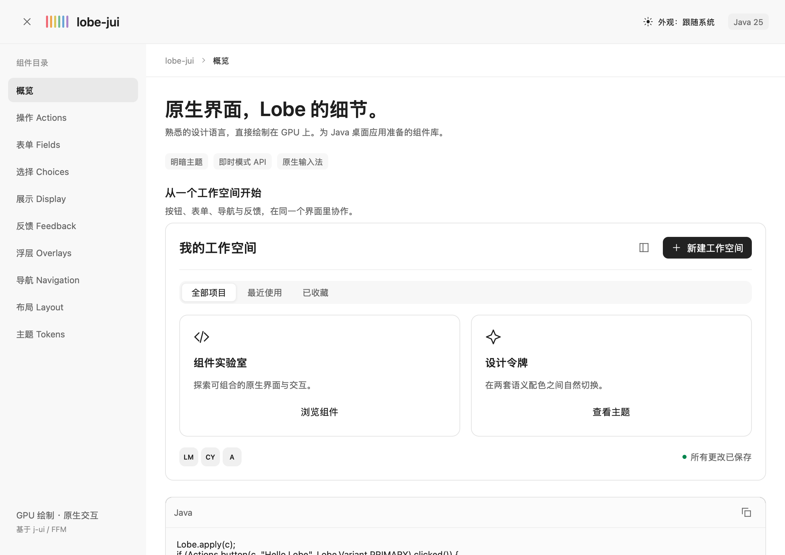
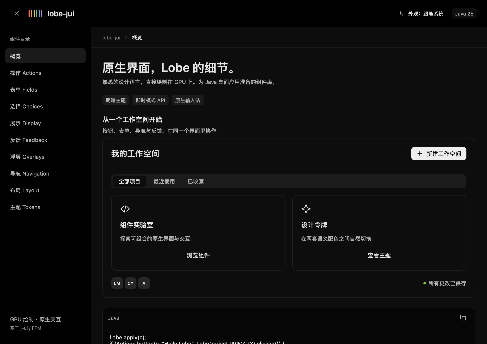

# lobe-jui

面向 j-ui 原生桌面应用的 Lobe 风格组件库，参考 [Lobe MyGo](https://mygo.lobehub.com/getting-started)。所有组件由现有 Java / FFM / GPU 路径绘制，无 WebView，无新增运行时依赖。包名为 `jui.lobe`，与 `jui.kit` 并存。

## 运行画廊

```bash
./build.sh demo lobe-jui
./build.sh demo Lobe --light
./build.sh demo Lobe --dark
./build.sh native-demo lobe-jui
```

画廊包括概览、操作、表单、选择、展示、反馈、浮层、导航、布局、主题十个页面。左上角按钮收起导航，右上角在跟随系统 / 浅色 / 深色之间切换。主内容可滚动，窄窗口下网格自动换行。

| 浅色 | 深色 |
| --- | --- |
|  |  |

以上预览来自真实 Engine → Scene → Metal 离屏渲染，1160 × 820 DIP、2 倍缩放，不含系统标题栏。

## 第一个窗口

在视图开始调用 `Lobe.apply(c)`，使基础控件和 lobe-jui 使用同一套主题；应用状态使用普通字段或 `Ref`，元素句柄只在当前构建中使用。

```java
import jui.app.App;
import jui.app.Window;
import jui.app.WindowOptions;
import jui.lobe.Actions;
import jui.lobe.Display;
import jui.lobe.Lobe;
import jui.lobe.Tokens;
import jui.ui.Context;
import static jui.ui.Ui.*;

public final class HelloLobe {
    private static int count;

    static void view(Context c) {
        Lobe.apply(c);
        column(c).fill().center().gap(16)
                .background(Tokens.of(c).bgContainer).children(() -> {
                    Display.heading(c, "Hello Lobe", 2);
                    Actions.button(c, "点击", Lobe.Variant.PRIMARY)
                            .onClick(() -> count++);
                    Display.secondary(c, "已点击 " + count + " 次");
                });
    }

    public static void main(String[] args) {
        App.run(() -> Window.open(WindowOptions.of("Hello Lobe")
                .size(480, 320).content(HelloLobe::view)));
    }
}
```

组件返回 j-ui 的 `Element`，可继续设置 `.width()`、`.disabled()`、`.label()`、`.onClick()`、`.shortcut()` 等。`clicked()` 也可直接读取；不要同时用两种方式执行同一次动作。标签供测试定位，`ActionIcon` 的名称目前不代表平台屏幕阅读器支持。

## 组件索引

| Java 类 | 已实现的组件 / 能力 |
| --- | --- |
| `Actions` | Button、ActionIcon、ActionIconGroup、CopyButton、Segmented |
| `Icon` | 23 个可着色的描边图标；未知名称抛错，避免悄悄显示错误图标 |
| `Fields` | Input、TextArea、InputPassword、SearchBar、FormItem、Select、AutoComplete、InputNumber、EditableText |
| `Choices` | Checkbox、Switch、RadioGroup、Slider、Rate、ColorSwatches |
| `Display` | Text（正文 / 次级 / 标题）、Tag、Avatar、GroupAvatar、Hotkey、Empty、Skeleton、Accordion |
| `Feedback` | Alert、Badge、Progress、Spin、Result、Modal、Drawer、Toast |
| `Overlays` | Tooltip、Popover、DropdownMenu、平台原生 ContextMenu |
| `Navigation` | Tabs、Pagination、Breadcrumb、Steps、Burger |
| `Layout` | Block、Divider、Grid / Cell、ScrollArea、Header、SideNav、DraggablePanel、GuideCard |
| `Code` | 可横向滚动、带剪贴板复制的纯文本 Snippet |
| `Tokens` / `Lobe` | 明暗语义令牌、状态颜色、主题接入和尺寸 |
| `Motion` | 引擎驱动的数值过渡、缓出函数 |

`jui.lobe` 无需导入 `jui.kit`；其输入、滚动、分割、浮层等共享现有 `jui.ui` 引擎。现有应用可以继续使用原 `jui.kit`。

## 外观约定

设计采用参考库的黑白灰体系：浅色容器 `#FFFFFF`、布局 `#F8F8F8`、文字 `#1F1F1F`、边框 `#E3E3E3`、主色 `#222222`；深色容器 `#0D0D0D`、布局 `#000000`、文字 `#E6E6E6`、主色 `#EEEEEE`。彩色只用于语义状态与少量品牌标记。字体使用现有系统排版栈，中文由系统回退。

主内容左对齐；外层导航与内容区分隔，边框用于说明组件和示例边界。主动动画只用于开关、加载指示与显式 `Motion.transition`，骨架保持静态。

```java
Actions.button(c, "新建", new Actions.ButtonProps(
        Lobe.Variant.PRIMARY, Lobe.Size.MIDDLE, "plus", false, false));
```

按钮变体为 `DEFAULT`、`PRIMARY`、`DASHED`、`FILLED`、`TEXT`、`LINK`；加载按钮与禁用按钮均不接受激活，父容器的禁用状态会被继承。

| Size | 高度 | 水平内边距 | 字号 | 圆角 |
| --- | ---: | ---: | ---: | ---: |
| SMALL | 24 | 8 | 12 | 6 |
| MIDDLE | 32 | 12 | 14 | 8 |
| LARGE | 40 | 16 | 16 | 12 |

`Tokens` 保留上游全部颜色与数值令牌；`Lobe.Size` 则采用 Lobe MyGo 按钮 API 的 24 / 32 / 40 DIP 尺寸，而非上游全局 `controlHeight` 的 27 / 36 / 45。`Tokens.of(c)` 返回缓存实例，`color("BgContainer")` 支持上游名称，未知名称抛出异常。

## 表单与状态

```java
private final TextRef name = new TextRef("");
private final IntRef selected = new IntRef(-1);
private final BoolRef open = new BoolRef(false);

// build 内：
Fields.formItem(c, "名称", null,
        () -> Fields.input(c, name, "输入名称"));
Fields.select(c, selected, open, "个人", "团队");
```

文本编辑复用 j-ui 的 IME、选区、撤销和剪贴板能力。`InputNumber` 支持输入与加减按钮；有效数值夹到范围内，不完整或非法文字不覆盖最后一个有效值，Enter 将显示文字规范为当前数值。外部更新 `DoubleRef` 会同步到输入框。`EditableText` 使用独立草稿，Enter 提交，Escape 放弃。

表单校验由应用提供：`formItem` 的 `error` 只负责展示。`Select` 与 `AutoComplete` 的开合状态由调用方持有，后者按不区分大小写的包含匹配筛选建议。

## 浮层与通知

`Popover` 等锚点浮层紧跟触发元素构建；引擎负责窗口内定位与边缘翻转。`Modal`、`Drawer`、`Toasts.host` 在窗口根容器末尾构建，避免祖先滚动裁剪。Modal / Drawer 复用引擎的焦点限制、返回焦点、Escape、遮罩点击关闭。

```java
private final Feedback.Toasts toasts = new Feedback.Toasts();

// 操作发生时：
Actions.button(c, "保存").onClick(() ->
        toasts.show(c, "已保存", Lobe.Status.SUCCESS));

// 根容器末尾，每帧构建：
toasts.host(c);
```

每个窗口持有一个 `Toasts` 实例，最多显示四条，三秒后由引擎定时唤醒移除。没有全局通知队列，不会串到其他窗口。

## 当前边界

这是原生 Java 组件库与本地画廊，尚未独立发布 Maven 包或搭建文档网站。参考站点中的 Markdown 流式渲染、语法高亮、QRCode、文件上传 / 图片选择、日期 / 颜色选择器等尚未移植；可以继续使用现有 `jui.kit` 中适用的组件。

当前图标是本库的小型自绘集合，不是完整 Lucide；Avatar 使用姓名首字母，GroupAvatar 并排排列；Skeleton 为静态占位；Snippet 为纯文本；Motion 没有另建弹簧物理系统。Select / Radio 支持 Tab 与 Enter / Space，未实现组合框特有的方向键选项导航；Tooltip 为即时悬停提示。框架级屏幕阅读器语义、系统减少动态效果偏好、Windows 真实窗口验收均不在本次验证内。

Select、AutoComplete 和 DropdownMenu 适合能在窗口内完整显示的选项列表；当前选项浮层内部不可滚动。

## 验证

```bash
./build.sh test LobeTest
./build.sh test
```

macOS 验证：20 项 lobe-jui 测试通过，全量 675 项通过。覆盖明暗主题及恢复跟随系统、按钮禁用 / 加载和键盘激活、中文输入、密码遮罩、多行文本、选择与筛选、重复名称、数字边界、编辑提交 / 取消、滑块、剪贴板、原生菜单、弹窗焦点恢复、抽屉定位、通知定时过期、导航、画廊所有页面与窄窗口。额外核对概览、按钮、表单、反馈、主题共十张明暗 Metal 离屏图。

JVM 画廊与 GraalVM native-image 画廊均已启动验证；本机 native-image 构建约 16.7 秒，生成可执行文件约 15.1 MiB。未执行真实鼠标全流程或 Windows 验证。

令牌来源与 MIT 许可见 [THIRD_PARTY_NOTICES.md](../THIRD_PARTY_NOTICES.md)。
